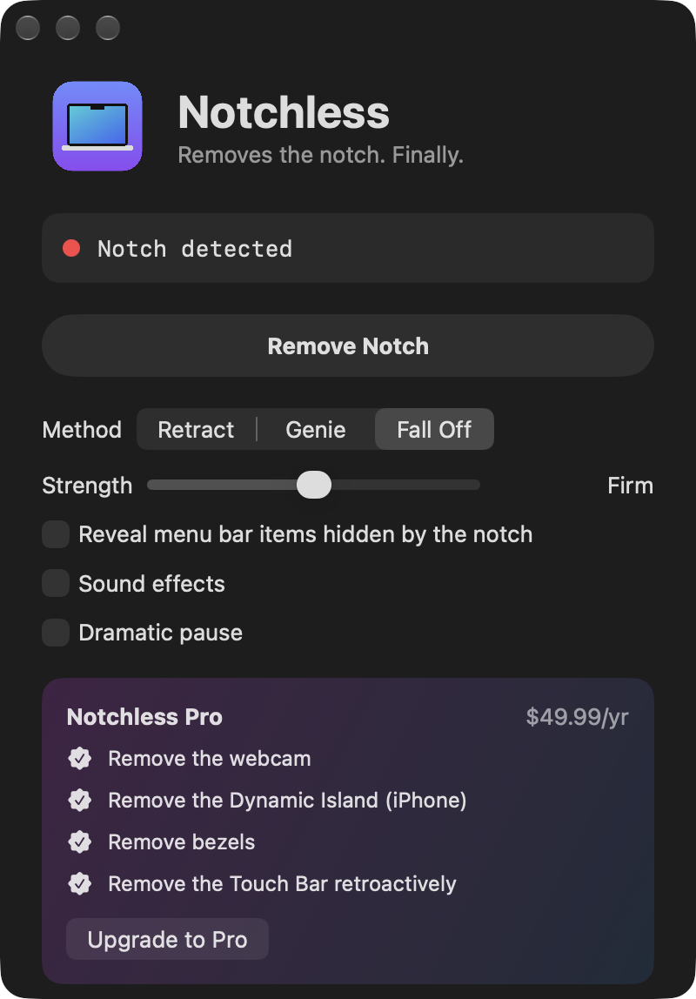

# Notchless

Removes the notch from your MacBook. Finally.



One click and the notch retracts into the bezel, gets sucked into the Dock like a minimised window, or wiggles loose and falls off your screen.

## How it works

Screen recordings of a MacBook don't show the physical notch. So Notchless draws a fake one exactly on top of the real one, in a click-through window above the menu bar, and animates that one away.

On camera, the notch is gone. In real life, your notch is still there. I'm sorry.

It's one Swift file, about 600 lines, with no dependencies.

## Install

Requires macOS 14 or later on Apple silicon, plus the Xcode Command Line Tools (`xcode-select --install`).

```sh
git clone https://github.com/DeckardGer/notchless.git
cd notchless
./build.sh --open
```

The app is ad-hoc signed. If you download a build from Releases instead of building it yourself, macOS will refuse to open it the first time. Open **System Settings → Privacy & Security** and click **Open Anyway**.

No notch? Notchless draws one for you, then removes it.

## Features

- Three removal methods: Retract, Genie and Fall Off
- Strength from Gentle to Nuclear
- Reveals the menu bar items that were hiding behind the notch the whole time (they are made up)
- Sound effects and an optional dramatic pause
- Restore your notch any time, with a bounce

## Notchless Pro

$49.99/yr. Removes the webcam, the Dynamic Island, your bezels and, retroactively, the Touch Bar.

Not available. Webcam removal requires a Phillips #000 screwdriver and voids your warranty.

## License

MIT
